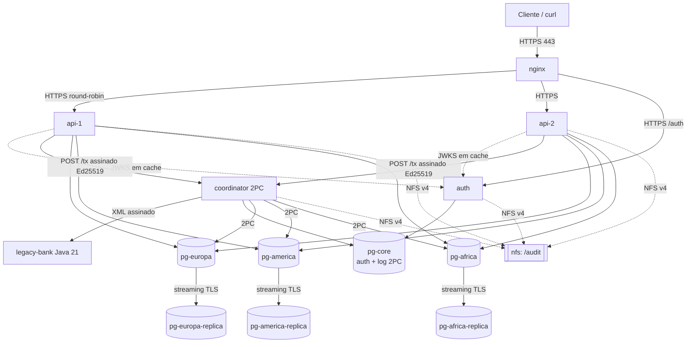

# Global-Scale System

Plataforma distribuída de transações financeiras internacionais de alta disponibilidade. Exame Prático Laboratorial de **Sistemas Distribuídos e Paralelos**, ISUTC, LECC 31.

Clientes da Europa, da América e de África têm os dados em **nós de base de dados diferentes** (um shard por região, cada um com réplica). Transferências entre regiões são **transações distribuídas com Two-Phase Commit**, com recuperação automática. O sistema continua a funcionar e **nunca fica inconsistente** quando cai um nó ou a rede.

| Área do exame | Onde está |
|---|---|
| Arquitetura, SO e Redes, DFS | Docker Compose, rede `globalnet` com IPs fixos e DNS `*.global.local`, NFS v4 (NFS-Ganesha) |
| Processamento e Transações | coordenador 2PC (`services/coordinator`), shards PostgreSQL com réplicas e failover |
| Serviços Web e Interoperabilidade | API REST FastAPI + banco parceiro em Java 21 com XML assinado; análise OMG/OMA |
| Segurança | TLS em tudo, JWT RS256 descentralizado, Ed25519 + SHA-256, AES-256-GCM em repouso, Argon2id |
| Documentação e Defesa | este README, [`docs/relatorio/`](docs/relatorio/README.md), 14 cenários de demo com evidências |

## Índice

1. [Arquitetura](#arquitetura) · 2. [Requisitos e arranque](#requisitos-e-arranque) · 3. [Rede](#rede) · 4. [DFS (NFS v4)](#sistema-de-ficheiros-distribuído-nfs-v4) · 5. [Base de dados](#base-de-dados-distribuída-postgresql-16) · 6. [Autenticação](#autenticação-serviço-auth) · 7. [API](#api-api-1-e-api-2-atrás-do-nginx) · 8. [2PC](#transferências-e-two-phase-commit-serviço-coordinator) · 9. [Legado Java](#módulo-legado-banco-parceiro-java-21-xml) · 10. [Auditoria e admin](#auditoria-relatórios-e-administração-nfs) · 11. [Demonstração](#cenários-de-demonstração) · 12. [Testes](#testes) · 13. [Decisões técnicas](#decisões-técnicas) · 14. [Limitações](#limitações-conhecidas) · 15. [Estrutura](#estrutura-do-repositório)

## Arquitetura



| Contentor | Tecnologia | Função |
|---|---|---|
| `nginx` | Nginx 1.27 | único ponto exposto (443); balanceador com failover entre api-1/api-2; re-encripta TLS |
| `api-1`, `api-2` | Python 3.12, FastAPI | API pública sem estado; valida JWT localmente; routing por região |
| `auth` | Python 3.12, FastAPI | registo, KYC, login, JWT RS256, JWKS; único com a chave privada |
| `coordinator` | Python 3.12, FastAPI, psycopg 3 | coordenador 2PC, log durável, recuperação, liquidação com o legado |
| `legacy-bank` | Java 21 (só JDK) | "mainframe" do banco parceiro: XML assinado, ledger de largura fixa |
| `nfs` | NFS-Ganesha | DFS: auditoria e relatórios partilhados |
| `pg-core` | PostgreSQL 16 | BD `auth` e BD `coordinator` |
| `pg-europa` (+réplica) | PostgreSQL 16 | shard Europa (`GS-EU-*`) |
| `pg-america` (+réplica) | PostgreSQL 16 | shard América (`GS-AM-*`) |
| `pg-africa` (+réplica) | PostgreSQL 16 | shard África (`GS-AF-*`, moeda base MZN) |

## Requisitos e arranque

- Windows + WSL2 (Ubuntu) + Docker Desktop com integração WSL ativa (testado com 16 GB de RAM; o WSL usa ~8 GB)
- No Ubuntu: `git`, `openssl`, `python3` + `python3-venv`, `make`, `jq`, `curl`
- Repositório dentro do sistema de ficheiros do WSL (`~/global-scale-system`), não em `/mnt/c`
- Porta 443 livre no host

```bash
git clone https://github.com/rooneyreis/Exame_SDP.git ~/global-scale-system && cd ~/global-scale-system
./scripts/gen-certs.sh        # CA local + certificado TLS por serviço   (infra/certs, não versionado)
./scripts/gen-keys.sh         # RS256 (JWT), Ed25519 (assinaturas), AES-256 (dados em repouso)   (infra/keys)
docker compose up -d --wait   # 14 contentores
./scripts/seed.sh             # câmbios, 3 contas por shard, staff e 9 clientes
make test                     # testes unitários + integração (~5 min)
./scripts/demo/run-all.sh     # os 14 cenários de demonstração (~5 min)
```

Documentação interativa da API: `https://localhost/docs` (OpenAPI gerada pelo FastAPI).

**Num servidor** (Ubuntu, 8 GB de RAM recomendados): `sudo bash scripts/deploy.sh` instala tudo e arranca. Ver [`docs/DEPLOY.md`](docs/DEPLOY.md).

## Rede

Rede Docker bridge `globalnet`, subnet `172.28.0.0/24`, IPs fixos. Cada serviço tem também o alias DNS `<nome>.global.local`, que é o nome usado nos certificados TLS (SAN).

| Serviço | IP | Porta |
|---|---|---|
| nginx | 172.28.0.10 | 443 (única exposta no host) |
| api-1 / api-2 | 172.28.0.11 / .12 | 8000 |
| auth | 172.28.0.20 | 8010 |
| coordinator | 172.28.0.30 | 8020 |
| legacy-bank | 172.28.0.40 | 9443 |
| nfs | 172.28.0.50 | 2049 |
| pg-core | 172.28.0.60 | 5432 |
| pg-europa / réplica | 172.28.0.61 / .62 | 5432 |
| pg-america / réplica | 172.28.0.63 / .64 | 5432 |
| pg-africa / réplica | 172.28.0.65 / .66 | 5432 |

## Sistema de ficheiros distribuído (NFS v4)

**Solução que funcionou: NFS-Ganesha** (opção 1 de 3), servidor NFS em espaço de utilizador no contentor `nfs`.

- Não depende dos módulos `nfsd` do kernel do WSL2/Docker Desktop, por isso não precisa de `privileged`. Só precisa da capability `DAC_READ_SEARCH`, porque o backend VFS do Ganesha usa `open_by_handle_at()`.
- Só NFS v4: não é preciso `rpcbind`/`mountd`/NLM, os locks fazem parte do protocolo.
- Os outros contentores montam `nfs:/audit` através de um **volume Docker do tipo NFS**. Quem faz o mount é o daemon Docker, por isso os contentores clientes não precisam de privilégios.
- `Graceless = true`: o servidor salta o *grace period* de 90 s após arrancar. Em produção esse período serve para os clientes recuperarem os seus locks depois de um reinício do servidor. Ver limitações.
- Os avisos `DBUS` e `krb5` nos logs do `nfs` são esperados (não usamos D-Bus nem Kerberos).

Validação (`tests/integration/test_phase0_nfs.py`): dois contentores escrevem no mesmo export ao mesmo tempo. Cada um lê o ficheiro do outro e ambos incrementam 200× um contador partilhado com `fcntl.lockf` (lock exclusivo). O resultado é exatamente 400, sem atualizações perdidas.

## Base de dados distribuída (PostgreSQL 16)

| Nó | Conteúdo |
|---|---|
| `pg-core` | BD `auth` (utilizadores, refresh tokens) e BD `coordinator` (log 2PC, eventos, câmbios) |
| `pg-europa` → `pg-europa-replica` | BD `bank` do shard Europa (só IBANs `GS-EU-…`) + réplica streaming |
| `pg-america` → `pg-america-replica` | BD `bank` do shard América (só IBANs `GS-AM-…`) + réplica streaming |
| `pg-africa` → `pg-africa-replica` | BD `bank` do shard África (só IBANs `GS-AF-…`, contas em MZN) + réplica streaming |

### Regiões: uma única fonte de verdade

As regiões servidas vêm de `GSS_REGIONS` (`.env` / `docker-compose.yml`, por omissão `EU,AM,AF`). Em `common/db.py`, o padrão do IBAN (`^GS-(EU|AM|AF)-[0-9]{8}$`), os nós de cada shard e a moeda base de cada região (EUR, USD, MZN) são gerados a partir dessa lista. Os tipos dos pedidos (`Literal[REGIONS]`) também, por isso uma região desconhecida dá `422`. No coordenador, `REGION_ORDER = ("EU", "AM", "AF")` é a ordem global de bloqueio, e o serviço recusa arrancar se faltar lá alguma região. No browser, a tabela equivalente está em `frontend/assets/js/format.js`.

Para acrescentar uma região: um par de contentores `pg-<nome>` / `pg-<nome>-replica` no compose, o certificado em `gen-certs.sh` (os existentes são mantidos), a entrada em `REGION_CATALOG` e `REGION_ORDER` e uma migração das constraints de região (`infra/postgres/migrations/*/002_region_africa.sql` é o exemplo).

- **Fragmentação horizontal por região**: a regra está no próprio esquema (`CHECK (iban ~ '^GS-EU-[0-9]{8}$')` no shard EU). Uma conta da região errada é recusada pela BD.
- **TLS obrigatório**: `pg_hba.conf` só tem `hostssl`. Qualquer ligação sem TLS é rejeitada (`no encryption`). Os clientes usam `sslmode=verify-full`, que verifica a CA e o nome do servidor (SAN). A replicação também corre sobre TLS (TLS 1.3).
- **2PC**: `max_prepared_transactions = 100` em primários e réplicas.
- **Roles por serviço** com privilégio mínimo: `auth_svc` (só BD auth), `coord_svc`, `api_svc`.
- **Um só entrypoint** (`infra/postgres/entrypoint.sh`) para todos os nós:
  1. copia o certificado do nó com permissões `0600`;
  2. réplica com o diretório vazio → `pg_basebackup -R` do primário;
  3. antigo primário que volta depois de um failover → deteta que o par já é primário e **volta como réplica** (evita split-brain).

### Failover

```bash
docker stop pg-europa
./scripts/failover.sh EU     # pg_promote() na réplica (EU, AM ou AF)
docker start pg-europa       # volta sozinho como réplica do novo primário
```

Os serviços ligam-se com conninfo multi-host (`host=pg-europa.global.local,pg-europa-replica.global.local target_session_attrs=read-write`): depois da promoção, as novas ligações vão para o novo primário sem mudar configuração. As **transações preparadas** (fase 1 do 2PC) estão no WAL, por isso aparecem em `pg_prepared_xacts` no nó promovido e o coordenador pode concluí-las lá. Na réplica em standby só ficam visíveis depois da promoção.

## Autenticação (serviço `auth`)

Acesso pelo Nginx: `https://localhost` (a CA local valida o certificado: `curl --cacert infra/certs/ca.crt`).

| Método | Endpoint | Quem |
|---|---|---|
| POST | `/auth/register` | público → `PENDENTE_VERIFICACAO` |
| POST | `/auth/login` | público → `access_token` (JWT RS256, 15 min) + `refresh_token` (7 dias) |
| POST | `/auth/refresh` | público: roda o refresh token |
| POST | `/auth/logout` | autenticado |
| GET | `/.well-known/jwks.json` | público: chave pública RS256 |
| GET | `/admin/users?status=…`, `/admin/users/{id}` | operador, admin (o detalhe decifra documento e data de nascimento) |
| POST | `/admin/users/{id}/approve-kyc` | operador: cria a conta no shard (via api) e ativa |
| POST | `/admin/staff` | admin |

Utilizadores de demonstração (`./scripts/seed.sh`):

| Email | Role | Senha |
|---|---|---|
| `admin@globalscale.test` / `operador@…` / `auditor@…` | admin / operador / auditor | `Staff#2026` |
| `ana.silva@`, `bruno.costa@`, `carla.mendes@cliente.test` | cliente EU (`GS-EU-00000001..3`) | `Cliente#2026` |
| `david.smith@`, `emily.johnson@`, `frank.miller@cliente.test` | cliente AM (`GS-AM-00000001..3`) | `Cliente#2026` |
| `amina.mussa@`, `jorge.macuacua@`, `lurdes.cossa@cliente.test` | cliente AF (`GS-AF-00000001..3`, MZN) | `Cliente#2026` |

```bash
TOKEN=$(curl -s --cacert infra/certs/ca.crt https://localhost/auth/login \
  -H 'content-type: application/json' \
  -d '{"email":"ana.silva@cliente.test","password":"Cliente#2026"}' | jq -r .access_token)
```

Segurança aplicada:
- **Senhas**: Argon2id. O hash corre numa thread (`asyncio.to_thread`) para não bloquear o event loop.
- **Bloqueio**: 5 falhas seguidas → `423` durante 15 min. `SELECT … FOR UPDATE` serializa logins paralelos do mesmo utilizador, para não se contornar o contador.
- **Sem enumeração de utilizadores**: email inexistente e senha errada dão a mesma resposta, e o tempo de resposta é igual (verificação Argon2 contra um hash fictício).
- **JWT RS256** com `kid` (thumbprint RFC 7638). Só o `auth` tem a chave privada. A validação exige `exp`, `iss`, `aud`, `kid` e `alg=RS256` (bloqueia `alg: none`).
- **Refresh tokens**: guardados só como SHA-256. Rodam a cada uso, e um token revogado usado de novo revoga todas as sessões do utilizador (deteção de roubo).
- **Dados em repouso**: `document_id` e `birth_date` cifrados com AES-256-GCM (`nonce || ciphertext || tag`), com o `user_id` como *associated data*. A chave (`infra/keys/private/auth-data.key`) só está montada no contentor `auth`.
- **KYC**: a aprovação cria primeiro a conta (chamada à api com um token de serviço `role=service`, 60 s). Se a api estiver em baixo → `503` e o utilizador continua pendente.

## API (api-1 e api-2 atrás do Nginx)

| Método | Endpoint | Quem |
|---|---|---|
| GET | `/me`, `/accounts` | cliente (contas no shard da sua região) |
| GET | `/accounts/{iban}` | dono, operador |
| GET | `/accounts/{iban}/movements` | dono, operador, auditor |
| POST | `/accounts/{iban}/deposit`, `/withdraw` | operador (transação local no shard) |
| GET | `/fx-rates` | autenticado |
| POST | `/internal/accounts` | `role=service` (chamado pelo auth no KYC; idempotente) |
| GET | `/health` | público: estado dos shards (nó que responde) e chaves JWKS em cache |

- **Validação JWT descentralizada**: cada instância descarrega o JWKS do auth no arranque e a cada 10 min. Se o auth cair, continua a validar com a chave em cache (cenário 07).
- **Routing por região** centralizado em `common/db.py`: o prefixo do IBAN (`GS-EU-`/`GS-AM-`/`GS-AF-`) escolhe o pool do shard; o claim `region` do JWT escolhe o shard das contas do utilizador.
- **Movimentos** têm `origin` (`TRANSFERENCIA`/`DEPOSITO`/`LEVANTAMENTO`): depósitos e levantamentos são transações locais do shard, as transferências passam pelo coordenador (Fase 4).
- **Nginx**: round-robin entre `172.28.0.11` e `172.28.0.12`. `proxy_next_upstream error timeout http_502 http_503`: se uma instância não responde, o pedido é repetido na outra e a falhada fica de fora durante `fail_timeout=10s`. POSTs só são repetidos se nunca chegaram ao backend, por isso um depósito nunca é executado duas vezes. O TLS até aos backends é verificado (`proxy_ssl_verify on`, nome `api.global.local` presente nos dois certificados).
- Header `X-Served-By` mostra que instância respondeu.
- **Leituras com o primário em baixo**: os endpoints só de leitura tentam o primário (2 s) e, se não responder, usam a réplica (`target_session_attrs=any`). Saldos e extratos continuam disponíveis durante a falha (cenário 08); as escritas esperam pelo failover.
- Uma BD indisponível dá `503` (nunca `500`).
- Ligações aos shards com keepalives TCP e `tcp_user_timeout=8s`: um nó isolado pela rede é detetado em segundos, não em minutos (cenário 13).

## Transferências e Two-Phase Commit (serviço `coordinator`)

`POST /transfers` (cliente, header `Idempotency-Key` obrigatório) → a api valida (conta do próprio cliente, destino existe, 0 < montante ≤ 10 000) e envia ao coordenador um pedido **assinado com Ed25519** (`X-Payload-SHA256`, `X-Signature`, `X-Signer`; corpo em JSON canónico). `GET /transfers/{tx_id}` devolve o estado e a linha temporal (`tx_events`).

```mermaid
sequenceDiagram
    participant A as api-1/api-2
    participant C as coordinator
    participant L as pg-core (log)
    participant EU as pg-europa
    participant AM as pg-america
    A->>C: POST /tx (assinado Ed25519)
    C->>C: verifica assinatura + SHA-256 + janela temporal
    C->>L: INICIADA (commit)
    C->>L: PREPARANDO (commit)
    C->>EU: BEGIN; SELECT FOR UPDATE; UPDATE; INSERT; PREPARE TRANSACTION
    EU-->>C: voto SIM
    C->>AM: BEGIN; SELECT FOR UPDATE; UPDATE; INSERT; PREPARE TRANSACTION
    AM-->>C: voto SIM
    C->>L: DECISAO_COMMIT (commit) ← ponto de decisão
    C->>EU: COMMIT PREPARED
    C->>AM: COMMIT PREPARED
    C->>L: CONFIRMADA
```

- **Mesmo shard** → transação local normal (`kind=LOCAL`). **Shards diferentes** → 2PC (`kind=DISTRIBUIDA`), com `xid = (1, tx_id, região)`.
- **Log durável**: cada mudança de estado é gravada (commit) no pg-core **antes** de agir. A gravação de `DECISAO_COMMIT` é o ponto de decisão.
- **Recuperação (presumed abort)**, a cada 5 s:
  - `DECISAO_COMMIT` → `COMMIT PREPARED` onde ainda estiver preparada → `CONFIRMADA`;
  - `PREPARANDO` há mais de 30 s → `ROLLBACK PREPARED` → `ABORTADA`;
  - `INICIADA` local antiga → verifica se o commit chegou a acontecer (os movimentos existem?);
  - preparadas órfãs nos shards (`tpc_recover`) → decididas pelo log;
  - shard inacessível → nova tentativa com backoff exponencial (1, 2, 4… até 30 s).
- Transações **em curso** neste processo nunca são tocadas pelo recovery (ex.: a que está em `pause_after_prepare`).
- **Sem deadlocks distribuídos**: o PREPARE segue sempre a ordem global EU → AM → AF (e por IBAN dentro do mesmo shard). Numa transferência AF → AM, o crédito em AM é preparado antes do débito em AF. Nenhum PostgreSQL vê os locks do outro, por isso o deadlock não seria detetado: é evitado por ordenação de recursos. `lock_timeout = 5s` fica como segunda barreira.
- **Idempotência**: `tx_id = uuid5(user_id:Idempotency-Key)`, calculado pela api antes de chamar o coordenador. Se o coordenador morrer, o cliente já sabe o `tx_id` e repete com a mesma chave sem duplicar. Chave reutilizada com outros dados → `409`.
- **Câmbio**: taxa de `fx_rates` fixada no log no momento da transferência; arredondamento bancário (half-even) ao cêntimo.
- **Limite diário** verificado dentro do shard, com a conta bloqueada (`FOR UPDATE`), para transferências concorrentes não o ultrapassarem.
- **Contrapressão**: máximo de 20 transações em simultâneo no coordenador (semáforo asyncio).

Respostas: `201` CONFIRMADA, `200` repetição idempotente, `202` decisão tomada mas commit pendente num shard em baixo, `422` ABORTADA (com `failure_reason`), `503` coordenador indisponível (com `tx_id`).

### Injeção de falhas (`POST /admin/chaos`, só admin)

| Modo | Efeito |
|---|---|
| `{"pause_after_prepare": 20}` | espera 20 s depois do PREPARE, antes da decisão |
| `{"crash_after_prepare": true}` | `os._exit(1)` antes da decisão → recovery aborta (presumed abort) |
| `{"crash_after_decision": true}` | `os._exit(1)` depois da decisão → recovery faz COMMIT PREPARED |
| `{"fail_participant": "EU"}` | esse shard vota NÃO (`EU`, `AM` ou `AF`) |
| `{"off": true}` | desliga tudo (também volta a off sempre que o coordenador reinicia) |

`GET /admin/consistency` (auditor/admin): cada transação `CONFIRMADA` tem exatamente 1 débito e 1 crédito nos shards certos, as `ABORTADA` não têm movimentos, não há movimentos órfãos nem transações preparadas penduradas.

## Módulo legado: Banco Parceiro (Java 21, XML)

`legacy-bank/src/` simula o mainframe do banco parceiro, **sem frameworks**: `com.sun.net.httpserver.HttpsServer` (TLS com keystore PKCS12 da CA local), `javax.xml` DOM e `java.security` (Ed25519). Compilado com `javac` num build multi-stage (`eclipse-temurin:21-jdk` → `21-jre`). Cada pedido corre numa *virtual thread* do Java 21.

| Endpoint | Descrição |
|---|---|
| `POST /settlement` | recebe `<SettlementOrder>` assinado, responde `<SettlementAck>` assinado (`ACEITE`/`REJEITADA`) |
| `GET /settlements` | ordens aceites, em XML |

Contrato de interoperabilidade (Python ↔ Java):

```xml
<SettlementOrder version="1.0">
  <TxId>dca0276b-…</TxId> <FromIban>GS-EU-00000001</FromIban> <ToIban>GS-AM-00000001</ToIban>
  <Amount currency="EUR">100.00</Amount> <ConvertedAmount currency="USD">108.00</ConvertedAmount>
  <Timestamp>2026-11-19T23:54:50Z</Timestamp>
  <Sha256>…</Sha256> <Signature alg="Ed25519">…</Signature>
</SettlementOrder>
```

- `Sha256` e `Signature` são calculados sobre uma **string canónica** dos campos (`SettlementOrder|1.0|TxId|From|To|Amount|Cur|Converted|Cur|Timestamp`), igual nos dois lados. A assinatura não depende da formatação do XML, que o ElementTree (Python) e o DOM (Java) produzem de forma diferente. É uma alternativa simples à canonicalização XML-DSig.
- O legado verifica o SHA-256 e a assinatura do coordenador; o coordenador verifica o SHA-256 e a assinatura do ack do legado.
- Parser DOM **endurecido contra XXE**: DOCTYPE proibido, entidades externas desligadas, `FEATURE_SECURE_PROCESSING`. Corpo máximo de 64 KiB.
- Regra do banco: ordens com `ConvertedAmount > MAX_SETTLEMENT` (20 000) são `REJEITADA`.
- **Ledger de largura fixa** (`/data/ledger.dat`, estilo copybook COBOL, 121 colunas por registo; os montantes em cêntimos sem ponto decimal):

```
dca0276b-d89b-5c3d-ac71-3171e6284dc0GS-EU-00000001GS-AM-00000001000000000010000EUR000000000010800USD2026-11-19T23:54:50ZA
└─TxId(36)─────────────────────────┘└From(14)────┘└To(14)──────┘└Amount(15)───┘Cur└Converted(15)┘Cur└Timestamp(20)──────┘S
```

- **Liquidação assíncrona**: quando uma transferência `DISTRIBUIDA` fica `CONFIRMADA`, `settlement_status = PENDENTE` e o coordenador envia a ordem numa tarefa em segundo plano (o cliente não espera). Resposta → `ACEITE` ou `REJEITADA`. Se o legado estiver em baixo, fica `PENDENTE` e o recovery loop volta a tentar. O legado é idempotente por `TxId`.
- A rejeição da liquidação não desfaz a transferência (que já está confirmada nos shards): fica registada para tratamento posterior (em produção: estorno/compensação).

## Auditoria, relatórios e administração (NFS)

| Método | Endpoint | Quem | Descrição |
|---|---|---|---|
| GET | `/admin/audit?date=AAAA-MM-DD` | auditor, admin | lê os logs de todos os nós no NFS e valida cada cadeia de hashes; aponta a primeira linha adulterada |
| GET | `/admin/reports?date=` | auditor, admin | relatório diário partilhado (transações por estado/tipo, volume por região, depósitos/levantamentos) |
| GET | `/admin/status` | admin, auditor | estado de todos os nós: serviços (HTTPS `/health`), BDs (primário/réplica, réplicas em streaming, preparadas pendentes, TLS), NFS |
| GET | `/admin/consistency` | auditor, admin | invariantes do 2PC em todos os shards |

- **Auditoria à prova de adulteração**: cada nó escreve só no seu ficheiro `/audit/<AAAA-MM-DD>/<nó>.log` (sem conflitos de escrita). Cada linha JSON tem `prev_hash` e `hash = SHA-256(prev_hash + JSON canónico da linha)`. Alterar, apagar ou reordenar uma linha parte a cadeia a partir daí (cenário 05).
- **Relatório diário partilhado** `/audit/reports/<AAAA-MM-DD>.json`: um único ficheiro atualizado pelo coordinator **e** pelas duas api. Cada atualização é ler-modificar-escrever dentro de:
  1. `threading.Lock`, entre threads do mesmo processo, porque os locks POSIX pertencem ao processo e duas threads do mesmo processo não se bloqueariam com `fcntl`;
  2. `fcntl.lockf(LOCK_EX)`, entre processos e entre nós. No NFSv4 o lock é gerido pelo servidor.

  Os logs mostram `lock NFS adquirido … (esperou X ms)` / `lock NFS libertado`. Teste: 20 depósitos simultâneos repartidos pelas duas api dão exatamente +20 no relatório.

## Interface web (banca digital)

`https://localhost/` → `https://localhost/app/`. HTML, CSS e JavaScript (módulos ES) em `frontend/`, **sem build e sem dependências externas**, servidos pelo nginx. Consome apenas as APIs existentes (mesma origem: sem CORS). Nenhuma lógica de negócio no browser.

| Perfil | Páginas |
|---|---|
| Cliente | Resumo (património, câmbio do dia, indicadores 30 dias, evolução do saldo, atividade recente), Contas e extrato (CSV), Transferir (nacional/internacional, estimativa de câmbio, revisão, resultado), Movimentos (filtros por estado/tipo/conta, pesquisa, CSV), Comprovativo imprimível com rastreio do processamento, Beneficiários, Perfil e segurança |
| Operador | Painel de operações, Nova transferência (em nome do cliente, com validação e câmbio), Operações (pendentes/concluídas/rejeitadas), Histórico, Beneficiários de clientes, Contas e caixa, Abertura de contas (KYC), Limites |
| Auditor | Painel de auditoria (consistência, integridade, alertas, falhas, volumes), Transferências com quem iniciou/aprovou, Pedidos e aprovações, Registos de auditoria e segurança, Conformidade, Contas, Beneficiários — tudo só leitura, exportação CSV/PDF |
| Admin | Visão geral (volumes, saldos sob custódia, limites, equipa), Aprovações, Transferências, Contas (limites e bloqueio), Utilizadores e perfis, Beneficiários, Limites, Registos, Conformidade, Infraestrutura e simulação de falhas |

- Estados técnicos traduzidos para linguagem bancária: `CONFIRMADA` → **Processada**, `ABORTADA` → **Falhada** (com o motivo explicado), restantes → **Pendente** (a página atualiza sozinha). Os eventos do 2PC aparecem no comprovativo como "Rastreio do processamento".
- Sessão em `sessionStorage`; o access token é renovado automaticamente com o refresh token antes de expirar.
- Transferências enviadas com uma `Idempotency-Key` por intenção: "Tentar novamente" depois de uma falha de rede nunca duplica.
- Design: fonte do sistema (SF Pro / Segoe UI), modo claro e escuro, `prefers-reduced-motion`, `prefers-reduced-transparency`, alto contraste, navegação por teclado, layout para desktop, tablet (menu lateral deslizante) e telemóvel (barra de separadores).
- Segurança no browser: todo o conteúdo vindo da API é escapado antes de entrar no HTML; `Content-Security-Policy` sem scripts inline nem recursos externos, `frame-ancestors 'none'`, `nosniff`, `no-referrer`, HSTS.
- Para abrir no Windows sem aviso de certificado, confiar na CA local (`infra/certs/ca.crt`) no repositório de certificados do utilizador.

Os beneficiários estão guardados no servidor (os que versões anteriores guardavam no browser são importados automaticamente). As referências das transferências **falhadas** enviadas pelo cliente continuam guardadas no dispositivo, porque o backend não tem um endpoint "as minhas transferências falhadas". As processadas aparecem sempre, porque vêm dos movimentos das contas.

## Perfis de acesso e RBAC

Quatro perfis, cada um com o seu painel. As permissões estão num único sítio, [`common/rbac.py`](common/rbac.py), e são **verificadas no backend em cada pedido** (`require_permission(...)` nos endpoints). O JWT só transporta o perfil, assinado pelo `auth`, e as permissões são derivadas no servidor. Esconder um botão nunca é a única proteção: uma chamada direta à API sem permissão recebe `403` e fica no registo de segurança (`ACESSO_NEGADO`, com utilizador, caminho e IP).

| | Cliente | Operador | Auditor | Administrador |
|---|:-:|:-:|:-:|:-:|
| As próprias contas, transferências e beneficiários | ✔ | | | |
| Registar transferências em nome de clientes | | ✔ | | |
| Depósitos e levantamentos, abertura de contas (KYC) | | ✔ | | |
| Gerir beneficiários de clientes | | ✔ | (ler) | ✔ |
| Consultar todas as contas e transferências | | ✔ | ✔ | ✔ |
| Aprovar / rejeitar pedidos de transferência | | | | ✔ |
| Gerir utilizadores e perfis | | | | ✔ |
| Configurar limites; bloquear contas e limites diários | | | | ✔ |
| Registos de auditoria e segurança, consistência, alertas | | | ✔ | ✔ |
| Volumes e relatórios financeiros, estado dos nós | | | ✔ | ✔ |

O **auditor é só de leitura** por construção: o perfil não tem nenhuma permissão de escrita (teste `test_auditor_is_strictly_read_only`). O **administrador** aprova, mas não regista transferências nem mexe em caixa (segregação de funções).

**Transferências registadas por operadores (maker-checker):**
- Abaixo do limiar de aprovação, são executadas de imediato pelo 2PC.
- A partir do limiar, ficam `PENDENTE_APROVACAO` até um administrador decidir. A transição é atómica (`UPDATE … WHERE status = 'PENDENTE_APROVACAO' AND created_by <> aprovador`), por isso quem registou nunca aprova e aprovar duas vezes não executa duas vezes (a `Idempotency-Key` deriva do pedido).
- Cada transação regista `initiated_by`, `initiated_role` e `approved_by`, assinados pela api e gravados pelo coordenador.

**Gestão de utilizadores (administrador):** criar, editar, mudar de perfil, bloquear, desbloquear (também limpa o bloqueio por tentativas falhadas), desativar e reativar. Regras no backend:
- ninguém altera o próprio perfil ou estado;
- clientes não passam a perfis de equipa;
- não se remove o último administrador ativo;
- mudar de perfil, bloquear ou desativar revoga as sessões (refresh tokens). O access token antigo expira em ≤ 15 min.

**Limites configuráveis** (`settings`): o montante máximo por transferência, aplicado pela api **e pelo coordenador**, e o limiar de aprovação. São lidos da BD em cada operação, por isso uma alteração vale de imediato nas duas instâncias da api. O limite diário e o estado de cada conta também são editáveis.

**Audit trail:** cada operação relevante fica no registo encadeado por SHA-256 no NFS, com identificador, responsável e perfil, ação, data/hora, `before`/`after`, resultado e IP. `GET /admin/audit/events` pesquisa e valida as cadeias. A BD não concede `DELETE` sobre transações nem pedidos à aplicação.

**Fiscalização (`GET /admin/suspicious`):** regras explícitas sobre os registos reais. Valores ≥ 80 % do máximo, ≥ 5 transferências da mesma conta em 10 min, falhas repetidas, liquidações rejeitadas, operações de operador acima do limiar sem aprovação, estados intermédios antigos, e recuperações automáticas do 2PC.

Endpoints novos: `/admin/users/{id}` (PATCH), `/admin/users/{id}/status`, `/admin/roles`, `/beneficiaries`, `/admin/beneficiaries`, `/transfer-requests` (+ `/approve`, `/reject`), `/admin/transfers`, `/admin/accounts` (+ PATCH), `/admin/settings`, `/admin/overview`, `/admin/suspicious`, `/admin/audit/events`.

Migrações de esquema em `infra/postgres/migrations/` (aplicadas uma vez, por ordem, por `scripts/migrate.sh`, que o `seed.sh` chama). Matriz real contra a API: `./scripts/rbac-smoke.sh`.

## Cenários de demonstração

Cada script imprime o que vai fazer, executa com `curl --cacert infra/certs/ca.crt`, mostra os resultados com `jq`, termina com erro ao primeiro resultado inesperado e grava a saída em `docs/evidencias/<cenário>.log`.

| Script | Demonstra |
|---|---|
| `01-registo-login.sh` | registo EU e AM → pendente → KYC → conta **no shard certo** (consulta direta a cada Postgres) → login → JWT |
| `02-transferencia-local.sh` | EU → EU, `kind=LOCAL` (uma transação, sem 2PC) |
| `03-transferencia-2pc.sh` | EU/EUR → AM/USD com câmbio; linha temporal do 2PC; liquidação no legado e registo no ledger |
| `04-idempotencia.sh` | o mesmo pedido 3× com a mesma `Idempotency-Key` → 1 débito |
| `05-adulteracao.sh` | 5 ataques ao canal api → coordinator recusados; linha alterada no NFS detetada por `/admin/audit` |
| `06-queda-api.sh` | `docker stop api-1` → todos os pedidos servidos pela api-2 |
| `07-queda-auth.sh` | `docker stop auth` → tokens existentes continuam válidos; login novo falha |
| `08-queda-shard-failover.sh` | `docker stop pg-europa` → leituras pela réplica → `failover.sh EU` → transferências sem mudar configuração → antigo primário volta como réplica |
| `09-queda-durante-2pc.sh` | `docker stop pg-america` entre o PREPARE e o COMMIT → recovery conclui quando volta |
| `10-crash-coordenador.sh` | coordenador morre depois da decisão → reinicia sozinho → `COMMIT PREPARED` pela recuperação |
| `11-concorrencia.sh` | 50 transferências concorrentes → 0 deadlocks, dinheiro conservado ao cêntimo |
| `12-tls.sh` | Postgres sem TLS, HTTP simples, TLS 1.1 e certificado de outro nó → tudo recusado |
| `13-particao-rede.sh` | `docker network disconnect` do pg-america depois e antes do PREPARE → commit concluído / abort sem débito |
| `14-regiao-africa.sh` | região África: registo AF → KYC → conta GS-AF em MZN no pg-africa; AF → AF local; 2PC EU → AF (EUR → MZN) e AF → AM (ordem EU → AM → AF); `fail_participant=AF` → rollback da Europa; failover e failback do shard África |

```bash
./scripts/demo/run-all.sh                 # todos, por ordem
PAUSE=1 ./scripts/demo/run-all.sh         # com pausas entre passos (apresentação ao docente)
PAUSE=1 ./scripts/demo/09-queda-durante-2pc.sh
```

Capturas de ecrã para o relatório: ver [`docs/evidencias/capturas/`](docs/evidencias/capturas/README.md).

## Testes

```bash
make test        # = ./scripts/test.sh: unitários (sem Docker) e depois integração (ambiente a correr)
```

| Tipo | Onde | O que cobre |
|---|---|---|
| Unitários (pytest) | `tests/unit/` | routing por região, câmbio (half-even), JSON canónico e assinaturas Ed25519, AES-GCM, JWT (expirado, `alg: none`, kid, adulterado), cadeia de hashes da auditoria, validação de senha/idade, decisões do recovery, contrato XML, agregação do relatório |
| Integração (pytest + httpx) | `tests/integration/test_phase*.py` | cada fase: NFS com locks, replicação e failover, TLS, auth (bloqueio, refresh, KYC), API, 2PC (commit, abort, presumed abort, crash depois da decisão, idempotência, adulteração), legado Java (XML válido, adulterado, acima do limite, XXE), auditoria, relatório concorrente, estado do cluster |
| Região África | `tests/integration/test_phase9_africa.py` | routing AF, KYC → GS-AF em MZN, AF → AF, 2PC EU → AF e AF → AM, abort com `fail_participant=AF`, recovery com `docker stop pg-africa` durante `pause_after_prepare`, `/admin/status` e `/admin/consistency` nos 3 shards; o failover AF está em `test_phase1_zz_failover.py` |
| Aceitação | `tests/integration/test_phase*_zz_demos.py` | os cenários de demonstração correm do princípio ao fim |

Alguns testes correm dentro dos contentores, porque o coordenador e o legado não estão expostos fora da rede: `tests/integration/tamper_client.py` (dentro da api-1) e `tests/integration/legacy_client.py` (dentro do coordinator).

## Decisões técnicas

| Decisão | Porquê |
|---|---|
| Fragmentação por região com a regra no esquema (`CHECK` no IBAN) e num único sítio do código (`common/db.py`) | dados perto dos clientes; a BD recusa dados da região errada mesmo que a aplicação erre |
| 2PC (e não Saga) para as transferências | o enunciado exige garantias ACID: nunca débito sem crédito. A Saga daria só consistência eventual |
| Ponto de decisão = commit de `DECISAO_COMMIT` no pg-core; presumed abort | se não há decisão gravada, ninguém fez commit, por isso abortar é sempre seguro |
| PREPARE pela ordem global EU → AM → AF (e por IBAN) | evita deadlocks distribuídos, que nenhum PostgreSQL consegue detetar sozinho |
| `tx_id = uuid5(utilizador:Idempotency-Key)` calculado pela api | o cliente sabe o `tx_id` mesmo se o coordenador morrer, e pode repetir sem duplicar |
| Conninfo multi-host (`target_session_attrs=read-write`) | failover transparente para os serviços, sem reconfiguração |
| Entrypoint Postgres que volta como réplica se o par já for primário | evita split-brain quando o antigo primário regressa |
| JWT RS256 + JWKS em cache | só o auth pode emitir; todos validam localmente, e o auth deixa de ser ponto único de falha para pedidos autenticados |
| Ed25519 sobre JSON canónico / string canónica no XML | integridade e origem; independente da formatação do JSON/XML entre Python e Java |
| AES-256-GCM com AAD = `user_id` | cifra autenticada: deteta adulteração e impede trocar valores cifrados entre utilizadores |
| NFS-Ganesha (espaço de utilizador) | não depende de módulos do kernel do WSL2; funciona sem `privileged` |
| Um ficheiro de auditoria por nó + um relatório partilhado com `fcntl.lockf` | logs sem conflitos de escrita; o relatório demonstra o acesso concorrente gerido pelo DFS |
| Python asyncio nos serviços, virtual threads no Java | sistema dominado por I/O de rede; concorrência simples e explícita |
| Leituras com fallback para a réplica | saldos e extratos disponíveis durante a queda de um primário, sem leituras desatualizadas quando o primário está bem |

## Limitações conhecidas

Desenvolvidas em [`docs/relatorio/10-limitacoes.md`](docs/relatorio/10-limitacoes.md):

- **Coordenador 2PC é um ponto único de falha temporário**: enquanto está em baixo, as transferências distribuídas ficam bloqueadas, mas **nunca inconsistentes** (log durável + recuperação). Em produção: coordenador replicado com consenso (Raft) ou padrão Saga.
- **O 2PC bloqueia** as contas entre o PREPARE e a decisão; a Saga trocaria isto por consistência eventual com compensações.
- **pg-core não tem réplica** neste protótipo (poderia ter, como os shards).
- **NFS com um único servidor** (ponto único de falha); em produção, GlusterFS/CephFS replicado. `Graceless = true` dispensa o *grace period* de recuperação de locks.
- **Failover do Postgres manual** (`failover.sh`); em produção, Patroni + etcd. Se os dois nós de uma região caírem e o antigo primário arrancar primeiro, as escritas feitas no promovido perdem-se.
- **Replicação assíncrona**: numa queda abrupta, as últimas transações (incluindo PREPAREs) podem não ter chegado à réplica. `docker stop` é uma paragem limpa e envia todo o WAL.
- Liquidação `REJEITADA` sem estorno automático; access token válido até expirar após logout; auditoria reescrevível por quem tem escrita no NFS (sem ancoragem externa).
- **KYC simulado**; taxas de câmbio fixas; todos os "nós" numa só máquina (latência entre regiões ≈ 0, mesmo kernel cliente NFS).

## Estrutura do repositório

```
global-scale-system/
├── docker-compose.yml          # 14 serviços, rede globalnet, volumes (incl. volume NFS)
├── Makefile, pytest.ini, requirements-dev.txt
├── common/                     # biblioteca Python partilhada (copiada para cada imagem)
│   ├── crypto.py               # AES-GCM, SHA-256, JSON canónico, Ed25519, pedidos assinados
│   ├── jwt_auth.py             # emissão (auth) e validação JWT RS256 via JWKS; dependências por role
│   ├── db.py                   # routing por região, conninfo multi-host, pools
│   ├── audit.py                # auditoria no NFS com hash encadeado
│   ├── reports.py              # relatório diário partilhado com fcntl.lockf
│   ├── rbac.py                 # perfis -> permissões (verificadas em cada endpoint)
│   ├── transfers.py            # tx_id = uuid5(utilizador:Idempotency-Key)
│   └── logging.py              # logs JSON com request_id / tx_id
├── services/
│   ├── auth/                   # registo, KYC, login, JWKS, staff
│   ├── api/                    # API pública (2 instâncias)
│   └── coordinator/            # 2PC, recuperação, chaos, liquidação (logic.py = regras puras)
├── legacy-bank/src/            # Java 21: HttpsServer, DOM seguro, Ed25519, ledger de largura fixa
├── frontend/                   # banca digital: index.html, assets/css, assets/js (módulos ES, sem build)
├── infra/
│   ├── nginx/nginx.conf
│   ├── postgres/               # postgresql.conf, pg_hba.conf (só hostssl), entrypoint, init SQL
│   ├── nfs/                    # NFS-Ganesha
│   ├── certs/                  # gerado por gen-certs.sh (não versionado)
│   └── keys/                   # gerado por gen-keys.sh (não versionado)
├── scripts/
│   ├── gen-certs.sh, gen-keys.sh, seed.sh, migrate.sh, failover.sh, test.sh, deploy.sh, rbac-smoke.sh
│   └── demo/                   # 14 cenários + run-all.sh + lib.sh + concurrency.py
├── tests/
│   ├── unit/                   # lógica pura, sem Docker
│   └── integration/            # contra o ambiente a correr
└── docs/
    ├── relatorio/              # rascunhos das secções do relatório técnico
    └── evidencias/             # saída de cada cenário (+ capturas/)
```
