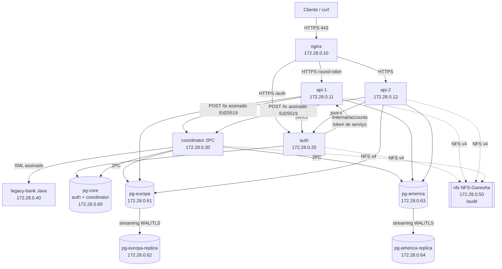

# Arquitetura do sistema (rascunho)

## Diagrama

(exportar para PNG com `mmdc` ou mermaid.live para o PDF)

## Nós

| Nó | IP | Porta | Tecnologia | Papel | Estado guardado |
|---|---|---|---|---|---|
| nginx | 172.28.0.10 | 443 (host) | Nginx 1.27 | ponto de entrada único, balanceador, terminação e re-encriptação TLS | nenhum |
| api-1, api-2 | .11, .12 | 8000 | Python/FastAPI | API pública *stateless*; valida JWT localmente | nenhum (cache do JWKS) |
| auth | .20 | 8010 | Python/FastAPI | emissor de tokens (único com a chave privada RS256), KYC | em pg-core/auth |
| coordinator | .30 | 8020 | Python/FastAPI | coordenador 2PC, recuperação, liquidação | log em pg-core/coordinator |
| legacy-bank | .40 | 9443 | Java 21 | mainframe do banco parceiro | ledger de largura fixa |
| nfs | .50 | 2049 | NFS-Ganesha (v4) | DFS para auditoria e relatórios | `/audit` |
| pg-core | .60 | 5432 | PostgreSQL 16 | BD `auth` e BD `coordinator` | utilizadores, log 2PC |
| pg-europa (+réplica) | .61 (.62) | 5432 | PostgreSQL 16 | shard Europa | contas `GS-EU-*` |
| pg-america (+réplica) | .63 (.64) | 5432 | PostgreSQL 16 | shard América | contas `GS-AM-*` |

## Rede

- Rede bridge Docker `globalnet` 172.28.0.0/24, IPs fixos; contentores sem IP fixo (clientes de teste) recebem um de 172.28.0.192/26, para nunca roubarem o IP de um serviço.
- DNS local: o DNS interno do Docker resolve `<nome>.global.local` (aliases definidos no Compose). Os certificados TLS usam estes nomes como SAN, por isso `verify-full` só aceita o servidor certo.
- Exposto no host: só a porta 443 do nginx.

## Fluxo de uma transferência distribuída

1. Cliente → nginx → api (TLS). A api valida o JWT com a chave pública em cache.
2. api → coordinator: pedido em JSON canónico assinado com Ed25519.
3. coordinator → pg-core (log) e → pg-europa / pg-america (2PC, TLS verify-full).
4. coordinator → legacy-bank: ordem de liquidação em XML assinado (assíncrona).
5. Todos os nós escrevem auditoria encadeada no NFS.

